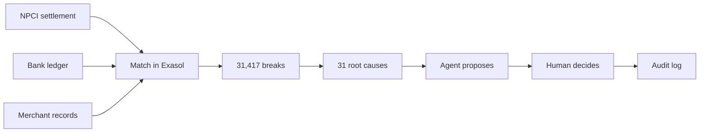

# CloseDesk

Governed UPI reconciliation on Exasol Personal.

**ExaThon India 2026 · Money, Risk & Regulation**

**Demo:** [Watch the 3-minute demo](https://drive.google.com/drive/folders/1N4V5nvlyClL3JZKy7FO-YJ1vm75NbuJg?usp=sharing)

A payments-operations analyst at a mid-size bank cannot close the day's UPI reconciliation. The NPCI settlement file, the core-banking ledger, and the merchant records disagree on thousands of transactions, and she traces each one by hand across spreadsheets. CloseDesk does that match inside Exasol and starts her day with a short list: each exception has a cause, the rupees at risk, and a proposed fix she can approve or reject.

Every proposal is gated. A human decides. The decision is written to an audit log in Exasol. CloseDesk does not post entries to a core-banking system.

> All payment rows are **synthetic**. There is no real UPI, customer, or employer data. Sources and licences: [docs/data-sources.md](docs/data-sources.md).

## At a glance

Measured on a day of 1,000,000 synthetic transactions. Same match counts on both runs. Details in [docs/results.md](docs/results.md).

| | |
|---|---|
| Auto-matched | **99.1%** · 980,583 of 989,666 NPCI rows |
| Accuracy vs planted answer key | **100%** precision · **99.79%** recall · **99.90%** F1 |
| What is left | **31,417** breaks, collapsed into **31** root causes |
| Time inside Exasol | **6.65 s** and **7.71 s** on two runs of the same day |
| Break types | **7 / 7** detected. Six at 100%, timing skew at 99% |



## What the pipeline does

1. **Generate or upload.** Build a synthetic day, or drop in three CSVs: NPCI settlement, bank ledger, merchant records. Uploads are checked for headers, column counts, amounts, and duplicate IDs before they touch Exasol.
2. **Load.** Bulk import with `pyexasol.import_from_iterable`.
3. **Match.** Three SQL stages, in order: exact reference, amount, and day; then a tolerance window; then many-to-one batch settlements.
4. **Classify.** Name what is left: missing settlement, duplicate ledger, amount mismatch, failed-but-debited, reversal not posted, status mismatch, orphans.
5. **Group.** Root causes are gateway × break type, ranked by rupees at risk and deadline.
6. **Propose.** The agent may only emit actions on an allow-list. A policy gate marks each proposal allow, escalate, or block. Explanations are templates, so no LLM key is required.
7. **Decide.** Approve and reject are recorded with the actor and the before/after state. A proposal the gate marked block cannot be approved.

## The dashboard

`make demo` opens five screens. All of them read live Exasol state.

| Screen | What you do there |
|---|---|
| Pipeline | Generate a day or upload three files, and watch each SQL stage finish |
| Investigate | Open one NPCI reference and see all three systems, the break, and the proposal |
| Inject & Detect | Plant a new break into the live data and watch it get caught |
| Exceptions | Work the queue, ranked by ₹ at risk. Approve or reject |
| Analytics | Funnel, break types, root causes, answer-key score, and the audit trail |

Sample files for the upload screen are in `samples/` and can be downloaded from the Pipeline screen. An upload has no answer key, so accuracy scoring is offered only for a generated day.

## Quick start

Full steps, including memory settings for the local VM: [docs/run-guide.md](docs/run-guide.md).

```bash
# Exasol Personal, Apple Silicon, 8 GB RAM or more
curl https://downloads.exasol.com/exasol-personal/installer.sh | sh
export PATH="$HOME/.local/bin:$PATH"
exasol install local
exasol connect

# This repo
git clone https://github.com/sharma-10-personal/closedesk.git
cd closedesk
cp .env.example .env       # EXA_PASSWORD from ~/.exasol/personal/deployments/default/secrets.json
make setup
make full                  # generate, load, match, propose, score. About 10 minutes for 1M rows
make demo                  # http://localhost:8501
```

`make full` replaces whatever day is currently loaded. Generating the million-row files is the slow part. The nine SQL stages after the load take under eight seconds.

## Where Exasol does the work

Matching, classification, root-cause grouping, priority, proposals, decisions, and the audit log all live in the `CLOSEDESK` schema. Python generates or validates files, loads them, and serves the UI. There is no Python loop over transactions and no Python UDF.

| Stage | What the SQL does | Recorded time |
|---|---|---|
| Exact match | Join on reference, amount, and calendar day | 3.92 s · 977,846 rows |
| Tolerance | Amount and time window on what exact missed | 0.57 s · 70 rows |
| Many-to-one | Merchant rows that sum to one NPCI amount | 0.68 s · 2,667 rows |
| Breaks, causes, priority | Four detectors, then group and rank | 1.48 s · 31,417 breaks, 31 causes |

The 83 misses are timing-skew rows whose shift crosses midnight, so the calendar-day join does not see them. That limit is written up in [docs/results.md](docs/results.md).

## Repository

```
closedesk/
├── closedesk/
│   ├── generator/     synthetic day, 7 planted break types
│   ├── loader/        CSV to Exasol
│   ├── engine/        runs the SQL stages and records timings
│   ├── agent/         allow-listed actions and the policy gate
│   ├── eval/          precision, recall, F1 against the answer key
│   └── app/           Streamlit dashboard
├── sql/               the reconciliation, executed inside Exasol
├── config/            policy.yaml, scenario.yaml
├── samples/           10,000-row CSVs for the upload screen
├── tests/             16 pytest tests
├── docs/              problem, architecture, results, run guide, pitch
└── data/              generated files, gitignored
```

## Submission

| | |
|---|---|
| Problem | This page and [docs/problem-statement.md](docs/problem-statement.md) |
| Architecture | [docs/architecture.md](docs/architecture.md) |
| Run and deploy | [docs/run-guide.md](docs/run-guide.md) |
| Data, APIs, tools | [docs/data-sources.md](docs/data-sources.md) |
| Measured results | [docs/results.md](docs/results.md) |
| Pitch deck | [docs/pitch/closedesk-pitch.pdf](docs/pitch/closedesk-pitch.pdf) |
| Demo video | [Sharma Exasol demo](https://drive.google.com/drive/folders/1N4V5nvlyClL3JZKy7FO-YJ1vm75NbuJg?usp=sharing) |
| Licence | [MIT](LICENSE) |

Original work for ExaThon India 2026.
